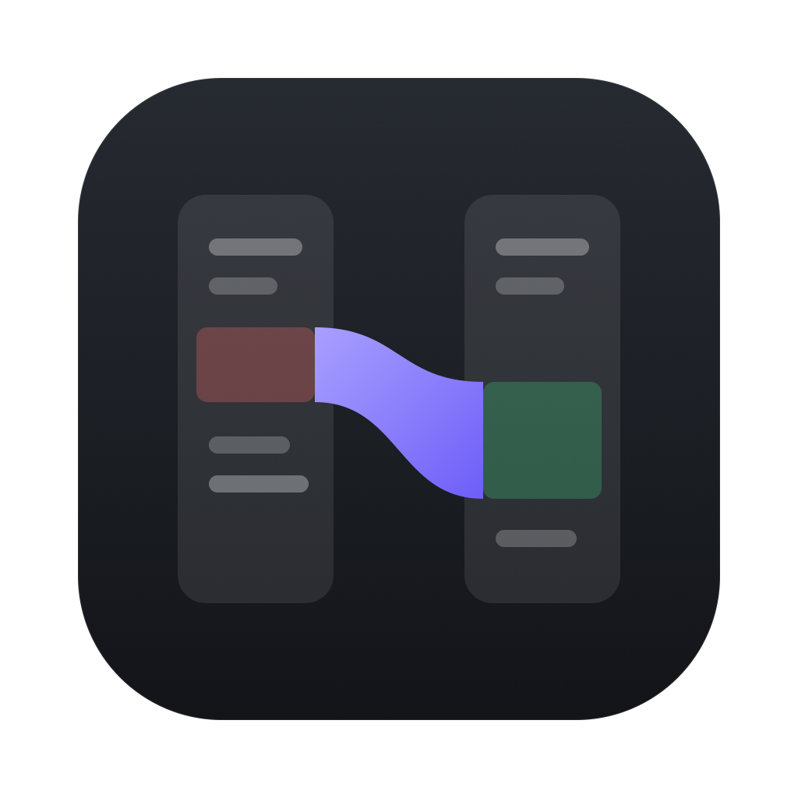
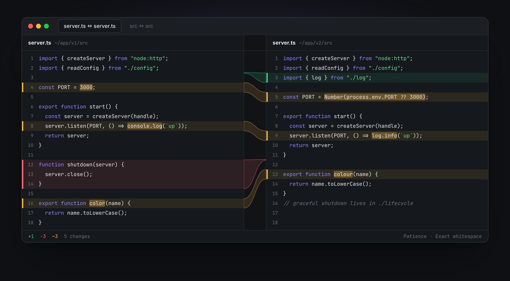

<p align="center">
  
</p>

<h1 align="center">Seam</h1>

<p align="center">
  A fast, quiet diff tool for files and folders. Free and open source, for macOS and Windows.
  <br>
  <a href="https://github.com/jaedanpersaud12/seam/releases/latest"><b>Download</b></a> ·
  <a href="https://seam-diff.vercel.app">Website</a> ·
  <a href="#use-it-as-your-git-difftool">git difftool</a>
</p>

<p align="center"></p>

---

Seam follows the workflow of classic visual diff tools like SourceGear DiffMerge: two panes side by side, a folder tree you can drill into, and a command you can hand to git. It has a modern UI, and the diff engine is written in Rust.

## Features

- **File diff.** Two editable panes. Changed lines are tinted, the exact words and characters that changed are highlighted, and curved ribbons in the middle show where each change on one side lands on the other.
- **Patience diff by default.** Moved functions and closing braces line up the way you'd expect. Myers and Histogram are one click away.
- **Copy changes across.** Hover a ribbon and press an arrow, or use `⌘]` / `⌘[`. Save each side with `⌘S`.
- **Folder diff.** Walks both trees in parallel and hashes contents with BLAKE3. Each file is marked identical, different, left only or right only, or *equivalent* when it differs only in ways you told Seam to ignore. You can view the result as a tree or as a sortable list.
- **Ignore what doesn't matter.** Trailing whitespace, amounts of whitespace, all whitespace, case, and line endings.
- **Paste to compare.** Open a text comparison and paste two snippets. No files needed.
- **Knows its files.** Detects encodings (UTF-8, UTF-16, Latin-1) and line endings, and writes them back unchanged when you save. Binary files get a hash comparison instead of a text diff.
- **Notices outside changes.** If a file changes on disk, Seam reloads it silently, or asks first when you have unsaved edits.
- **Overview strip.** A map of every change in the file, which you can drag to scrub through it. `F7`/`F8` jump between changes.
- **Keyboard first.** `⌘K` opens a command palette for everything, including recent comparisons.
- **Polished motion that respects Reduced Motion.** Every animation can be interrupted, and states never shift the layout. Built on components from [interior.dev](https://interior.dev).
- **Light, dark, and a colour-blind safe palette.**

## Install

Download the latest build from [Releases](https://github.com/jaedanpersaud12/seam/releases/latest):

| Platform | File |
| --- | --- |
| macOS 11+ (Apple Silicon and Intel) | `Seam_x.y.z_universal.dmg` |
| Windows 10/11 | `Seam_x.y.z_x64-setup.exe` (or the `.msi`) |

> **Unsigned builds.** Seam isn't notarized by Apple or signed for Windows yet.
> - **macOS:** the first time you open it, right-click Seam in Applications, choose **Open**, then **Open** again. Or run `xattr -dr com.apple.quarantine /Applications/Seam.app`.
> - **Windows:** if SmartScreen appears, choose **More info**, then **Run anyway**.

## Use it from the terminal

On macOS, choose **Seam → Install Command Line Tool…**. This links `seam` into `~/.local/bin`.

```bash
seam left.txt right.txt          # compare two files
seam ./old ./new                 # compare two folders
seam a.rs b.rs --new-window      # open in a new window rather than a tab
seam a.rs b.rs --wait            # block until the comparison is closed
```

On Windows, run `Seam.exe <left> <right>` from the install folder.

### Use it as your git difftool

The install dialog offers to set this up for you. To do it by hand:

```bash
git config --global diff.tool seam
git config --global difftool.seam.cmd 'seam "$LOCAL" "$REMOTE" --wait'
git config --global difftool.prompt false
```

Then run `git difftool` (or `git difftool --dir-diff` for a folder comparison).

## Keyboard

| Action | Shortcut |
| --- | --- |
| Command palette | `⌘K` |
| New comparison | `⌘T` |
| Next / previous change | `F8` / `F7` |
| Copy change to right / left | `⌘]` / `⌘[` |
| Save this side / both sides | `⌘S` / `⌥⌘S` |
| Find | `⌘F` |
| Rescan or reload | `⌘R` |
| Close tab | `⌘W` |

On Windows, use `Ctrl` wherever this table shows `⌘`.

## Build from source

You need [Rust](https://rustup.rs) 1.90+, Node 22+, [pnpm](https://pnpm.io), and the [Tauri prerequisites](https://tauri.app/start/prerequisites/) for your platform.

```bash
pnpm install
pnpm tauri dev          # run in development
pnpm tauri build        # produce an installer in src-tauri/target/release/bundle
```

Tests:

```bash
cd src-tauri && cargo test     # diff engine, folder walker, encodings, CLI
pnpm vitest run                # scroll mapping and change-copy logic
```

## How it's built

| Layer | What it does |
| --- | --- |
| `src-tauri/src/engine/diff.rs` | Line diff ([`similar`](https://crates.io/crates/similar), patience by default). Changed lines are refined to words, then characters. Offsets are in UTF-16 so they match the editor. |
| `src-tauri/src/engine/folder.rs` | Walks both trees in parallel (`ignore` + `rayon`), compares by size then BLAKE3, and checks for equivalence under the ignore rules. |
| `src-tauri/src/engine/text.rs` | Detects binaries, encodings and line endings, and saves atomically. |
| `src/features/filediff` | CodeMirror 6 panes, diff decorations, connector ribbons, synced scrolling, overview strip. |
| `src/features/folderdiff` | Tree and list views of a folder comparison. |
| `src/components/interior` | Micro-interaction components adapted from [interior.dev](https://interior.dev) (MIT). Their behaviour is unchanged; only the styling is mapped to Seam's tokens. |

## Releasing

Push a version tag (`git tag v0.2.0 && git push --tags`). [`release.yml`](.github/workflows/release.yml) then builds the universal macOS DMG and the Windows installers, and publishes them as a GitHub Release.

## License

[MIT](LICENSE). The components in `src/components/interior` are adapted from [interior.dev](https://github.com/ddoemonn/interior), MIT © 2026 ozzy.

Seam is an independent project. It is not affiliated with SourceGear or DiffMerge.
